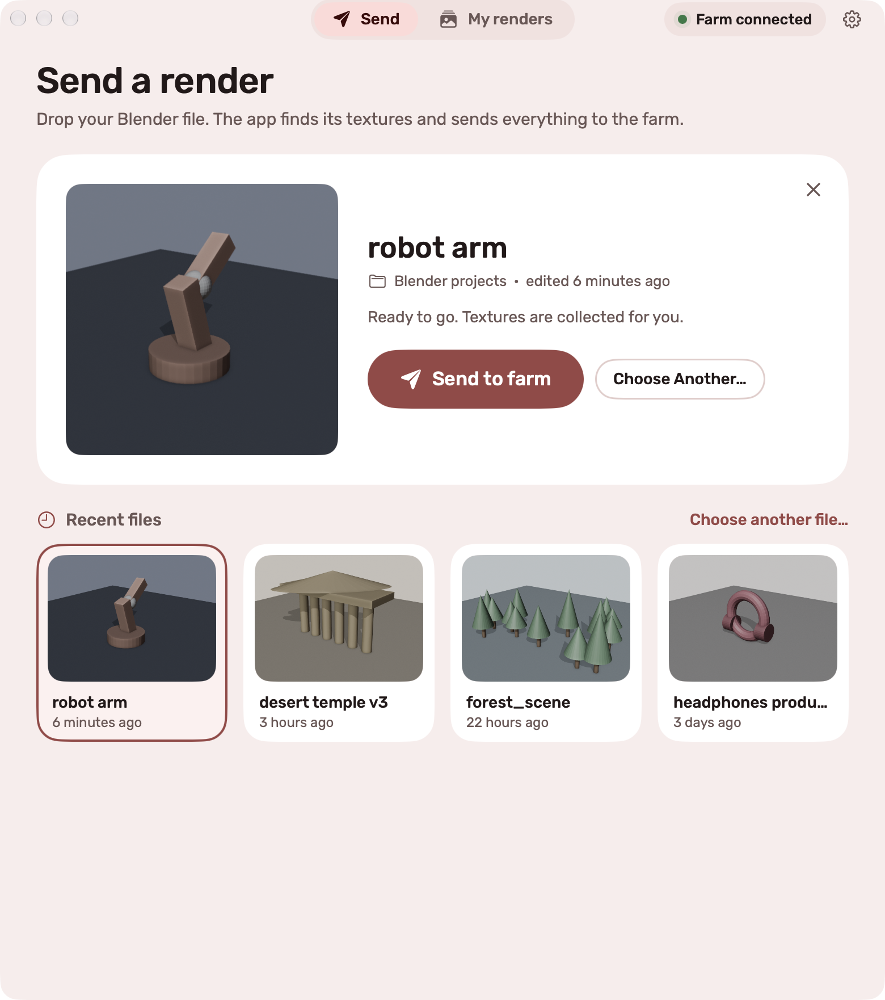

# Render Farm for Mac

A small macOS app for students who send Blender files to a school render farm. Before it uploads, it
collects every texture the `.blend` needs, so renders don't come out pink.



- Finds the farm's website on the local network over Bonjour (`_farmrender._tcp`, resolved to its
  host name, e.g. `farm.local`). You can also type an address in Settings. If macOS blocks Local
  Network access, the app says so and opens the right Settings pane.
- One screen: drop your `.blend` on the big card, or pick one of your most recent files (Spotlight;
  farm job copies, test fixtures, caches and Blender's splash files are left out). Then press
  **Send to farm**. Dropping a file on the Dock icon or using Finder's Open With sends it at once.
- **My renders** shows the farm's own website, so you sign in once and follow your job there.
- **Send to farm** runs your own Blender (`/Applications/Blender.app`) in the background on a copy of
  the file (`Resources/collect.py`):
  - It copies every image, UDIM tile, image sequence, sound, font, movie clip, volume, cache and
    linked library into a staging folder.
  - It finds moved files with Spotlight.
  - It saves a copy of the `.blend` with relative paths. Your own file is never changed.
- Files that still can't be found are listed, each with a **Find…** button. The farm also looks for
  them itself.
- Uploads go in 8 MB pieces and continue where they stopped if the Wi-Fi drops.

Requirements: Apple Silicon, macOS 26, Blender in `/Applications`.

The look follows the farm site (rose theme, Rubik, M3 Expressive motion; `Sources/FarmMac/Theme.swift`)
in light and dark mode, and respects Reduce Motion. Screenshots of every state are in
[docs/screenshots](docs/screenshots).

## Build

```sh
scripts/build.sh            # dist/Render Farm.app (ad-hoc signed)
swift test                  # unit tests + uploader against Tests/mock_farm.py
Tests/run_collect.sh        # collect.py with the real Blender on generated fixture scenes
scripts/screenshots.sh      # docs/screenshots, from Demo mode with generated scenes
```

Rubik is © The Rubik Project Authors, SIL Open Font License 1.1 (`Resources/Rubik-OFL.txt`).

Use the Swift that ships with Xcode (`/usr/bin/swift`). Some swift.org toolchains don't match the SDK.

## Server side

The farm's website must advertise itself, for example with avahi:
`_farmrender._tcp` on port 80. The upload API is the site's own folder upload: `POST /api/upload`,
`PUT /api/jobs/<id>/files`, then `POST /api/jobs/<id>/check`.
